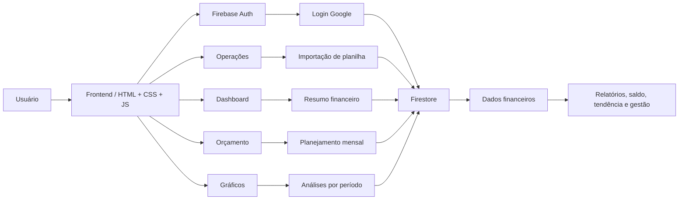

# Arquitetura do Dashfin

## Visão geral

O Dashfin é um dashboard financeiro pessoal construído como aplicação web estática, com lógica de negócio organizada em JavaScript e interface em HTML/CSS. O objetivo principal é reproduzir, em formato digital, a clareza e a organização de uma planilha de controle financeiro, mas com uma experiência moderna e mais amigável para acompanhamento diário.

## Modelo de negócio

A estrutura da aplicação foi inspirada em um fluxo financeiro real:

- controle por conta
- acompanhamento de saldo inicial e ajustes
- movimentações por período
- orçamento e comparação mensal
- análise de gastos e receitas
- importação de planilhas para revisão
- visão consolidada por conta e por categoria

Esse modelo permite que o usuário tenha uma leitura financeira mais robusta do que uma visão puramente de “receita x despesa”.

## Fluxo da aplicação

## Camadas do projeto

### 1. Frontend

A camada principal do sistema fica em `frontend/` e é composta por páginas independentes e estilos específicos por tela.

- `index.html` — visão geral e histórico
- `orcamento.html` — planejamento e acompanhamento do orçamento
- `graficos.html` — relatórios visuais e comparativos
- `operacoes.html` — importação, revisão e consolidação de dados

### 2. Lógica de negócio

A lógica de aplicação está em arquivos JavaScript, especialmente:

- `app-dashboard.js` — regras do dashboard, resumo por conta, orçamento e consolidação
- `app-constants.js` — configuração e referências principais
- `app-auth.js` — autenticação e gate de acesso
- `script.js` — utilidades e regras transversais

### 3. Persistência

A persistência de dados utiliza Firebase:

- `Auth` para autenticação
- `Firestore` para armazenamento de registros financeiros
- `firebase-config.js` para configuração inicial

### 4. Visual e UX

O design do Dashfin adotou uma abordagem premium com:

- shell lateral para navegação
- paleta em cinza, verde e dourado
- cards com hierarquia visual clara
- telas com consistência horizontal em todas as principais páginas
- foco em legibilidade, organização e sensação de gestão financeira profissional

## Regras de negócio relevantes

A aplicação foi pensada para preservar a lógica da planilha original, incluindo:

- acompanhamento de saldo por conta
- reconciliamento por período
- cálculo de variação líquida por conta
- agrupamento por categoria e período
- forecast de orçamento e comparação com realidade
- manutenção de saldos iniciais e ajustes do sistema configuráveis

## Observações da arquitetura

- O projeto é estático e leve, sem framework de front-end ou bundler.
- A organização foi feita para facilitar manutenção direta em arquivos HTML/CSS/JS.
- A evolução de design foi feita sem perder a lógica financeira base do sistema.
- O código deve continuar sendo simples, legível e com foco em clareza operacional.
